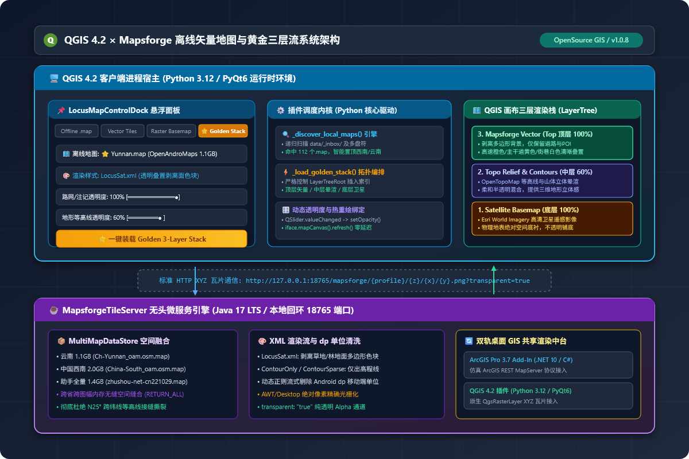
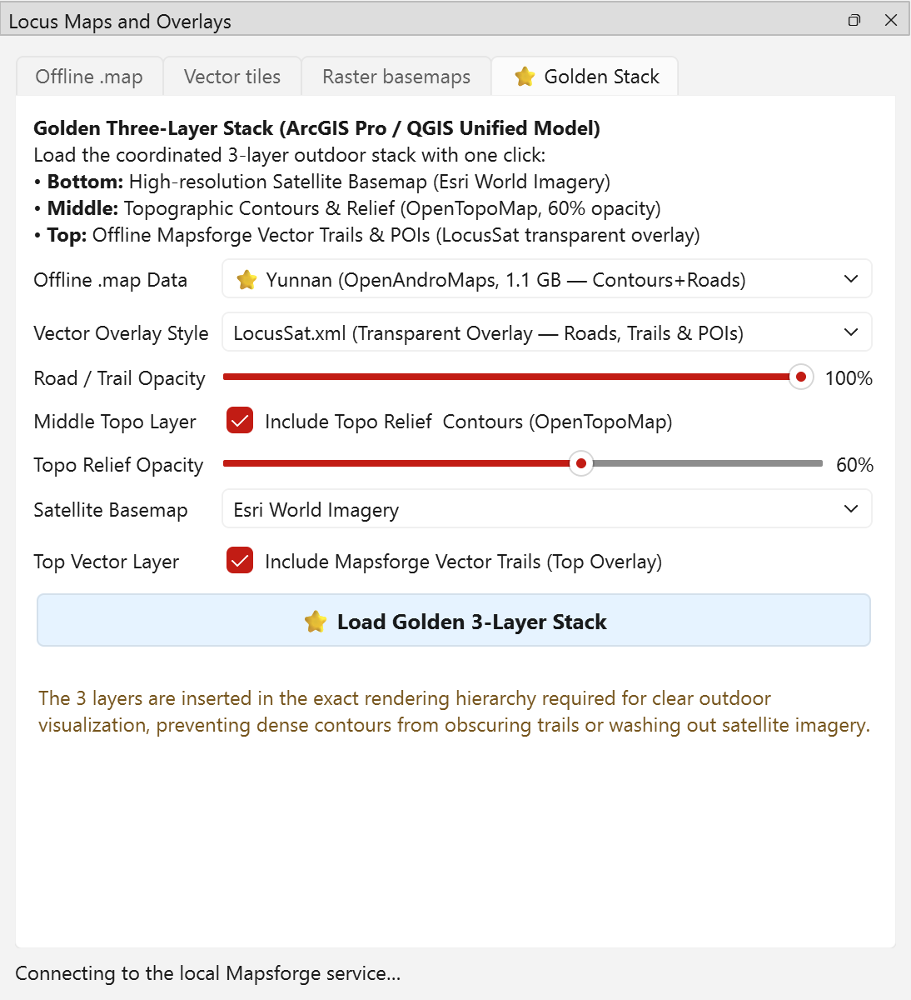
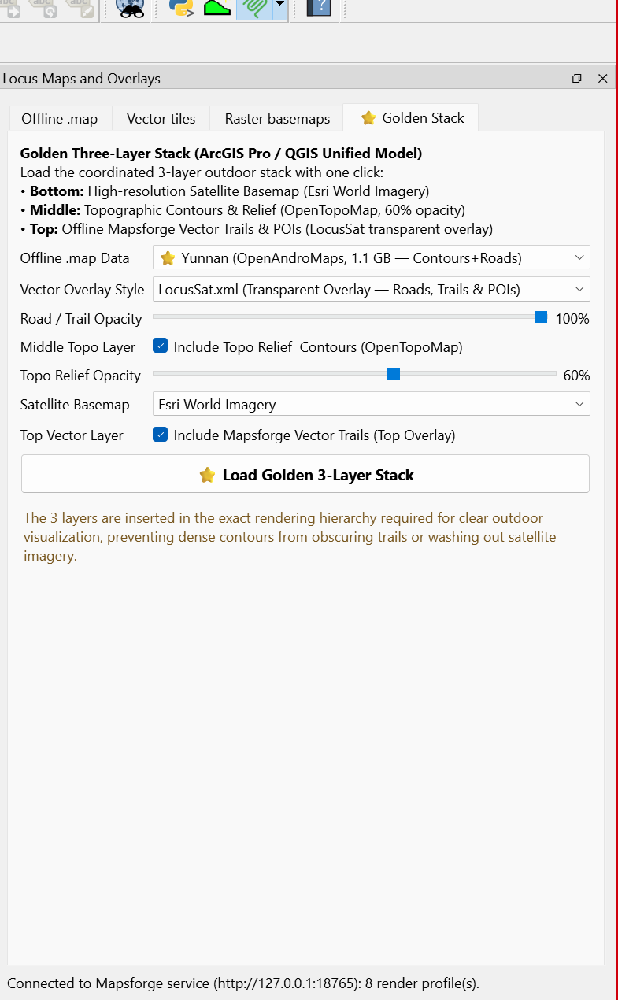

# Locus Map Control for QGIS (v1.1.0)

[](https://qgis.org/)
[](LICENSE)
[](https://github.com/Gmatrix2022/qgis-locus-layer-studio/releases)
[](https://github.com/Gmatrix2022/qgis-locus-layer-studio)

A professional, high-performance QGIS plugin bringing mobile outdoor offline vector maps (`.map`), vector tile overlays, and multi-source satellite/topographic basemaps into QGIS 3.x and QGIS 4.x.



---

## Key Highlights

- **⭐ One-Click Golden Three-Layer Stack (`黄金三层流`):** Instantly build an elite outdoor cartographic composition:
  1. **Bottom Layer**: High-resolution Satellite Imagery (Esri World Imagery / Google Satellite);
  2. **Middle Layer**: Topographic Contours & Hillshade (OpenTopoMap at 60% opacity);
  3. **Top Layer**: Offline Mapsforge vector trails, contours, and POIs at 100% opacity with transparent background.
- **🗺️ Offline Mapsforge Vector Engine:**
  - Reads binary vector `.map` files (OpenAndroMaps, Mapsforge v4/v5, Locus Map formats) containing raw OSM nodes, ways, and relations.
  - Bundled high-speed loopback renderer (`127.0.0.1:18766`) rendering on-demand crisp 256-pixel tiles.
  - Full support for outdoor themes: **LocusSat**, **Outdoor Full**, **Contour Only**, **Elevate** (v4/v5), and **Elements** (v4/v5) with bundled `ele-res` SVG/PNG iconography.
- **🛰️ Multi-Source Imagery & Basemaps:**
  - Integrated **Google Satellite** (Standard XYZ, Locus Proxy, Hybrid Roads/Labels).
  - Integrated **Esri World Imagery** and **OpenTopoMap**.
- **🌐 Native Vector Tile Overlays:**
  - OpenFreeMap Liberty, Bright, and Positron vector presets with client-side GL JSON styling.
  - Support for local `.mbtiles` and custom XYZ PBF/MVT tile endpoints.
- **🌍 Auto-Detecting Bilingual UI (i18n):**
  - Automatically matches QGIS user interface language (English default, Simplified Chinese `zh` for Chinese users).
- **💖 Integrated Sponsor / About Modal:**
  - Direct developer appreciation channel with WeChat Pay and Alipay donation QR codes.

---

## Live Screenshots in QGIS 4.2

### 1. The Golden Three-Layer Outdoor Stack

*Esri Satellite Base + 60% OpenTopoMap + 100% Transparent Yunnan Offline Vector Trails over Kunming Dianchi Lake.*

### 2. Plugin Panel Interface (Bilingual Adaptation)


---

## Understanding Offline `.map` Vector Files

Mapsforge `.map` files are **100% binary vector datasets**—not pre-rendered raster images. They contain indexed OSM geometries and attributes.

| Map Source | Format Version | Tile Size | Tag Mapping | Optimal Theme |
|---|---|---|---|---|
| **OpenAndroMaps** (`*_oam.osm.map`) | Mapsforge v5 | 256 px | OAM Custom Tags | `LocusSat.xml`, `Elevate.xml`, `Elements.xml` |
| **Locus Store Vector** (`*.osm.map`) | Mapsforge v4 | 512 px (Retina) | Locus Internal Tags | `LocusSat.xml` (Zoom 11+) |
| **Official Mapsforge** (`*.map`) | Mapsforge v5 | 256 px | Standard OSM Tags | `Outdoor Full.xml`, `Contour Only.xml` |

> **Note on Tile Size**: Standard Mapsforge tiles use 256x256 pixels. Maps designed specifically for mobile retina screens (such as 512px tile sizes) may require zooming in beyond zoom level 11 to display fine street networks.

---

## Installation

### Method A: Via Custom QGIS Plugin Repository (Recommended)
You can directly add this repository to QGIS so you can install and update the plugin with one click!

1. In QGIS, navigate to **Plugins** -> **Manage and Install Plugins...**.
2. Click **Settings** -> **Plugin Repositories** -> **Add...**.
3. Enter:
   - **Name**: `Locus Map Studio Repository`
   - **URL**: `https://raw.githubusercontent.com/Gmatrix2022/qgis-locus-layer-studio/main/plugins.xml`
4. Click **OK**.
5. Switch to **All** or **Not Installed**, search for `Locus Map Control`, and click **Install Plugin**.

### Method B: Install from ZIP Archive
1. Download [`qgis_locus_map_control.zip`](https://raw.githubusercontent.com/Gmatrix2022/qgis-locus-layer-studio/main/qgis_locus_map_control.zip).
2. In QGIS, open **Plugins** -> **Manage and Install Plugins...** -> **Install from ZIP**.
3. Select the downloaded `.zip` file and click **Install Plugin**.

---

## Usage Guide

1. Open the plugin via **Plugins** -> **Locus Maps** -> **Locus Map Control...**, or click the toolbar icon.
2. **Offline .map Tab**:
   - Click **Browse...** to pick your local `.map` file (e.g. `Ch-Yunnan_oam.osm.map`).
   - Select a Theme (`LocusSat`, `Elevate`, `Elements`, or `Contour Only`).
   - Choose **Transparent Overlay** (Top) or **Opaque Basemap** (Bottom).
   - Click **Add .map Layer**.
3. **⭐ Quick Stack**:
   - Click **One-Click Golden 3-Layer Stack** to automatically orchestrate Satellite + 60% Topo + 100% Vector Trails.
4. **Vector Tiles & Basemaps**:
   - Choose Google Satellite, Esri World Imagery, OpenTopoMap, or OpenFreeMap vector styles and load them directly into your layer tree.

---

## Project Structure

```
qgis-locus-layer-studio/
├── plugins.xml                 # QGIS official custom repository specification
├── qgis_locus_map_control.zip   # Ready-to-install plugin archive
├── plugin/
│   └── locus_map_control/      # Plugin root directory
│       ├── __init__.py         # Plugin entrypoint
│       ├── locus_map_control.py# Main GUI & controller (bilingual support)
│       ├── tile_sources.py     # Multi-source basemap & vector tile endpoints
│       ├── layer_order.py      # Layer hierarchy management
│       ├── metadata.txt        # QGIS plugin metadata (v1.1.0)
│       ├── styles/             # LocusSat, Outdoor, Elevate, Elements themes
│       │   ├── ele-res/        # High-res SVG/PNG icons for Elevate themes
│       │   └── ...
│       ├── renderer/           # Bundled Mapsforge loopback tile server
│       └── assets/             # Icons & developer sponsor QR codes
├── tests/                      # Automated test suite (PyTest)
├── docs/                       # Architecture diagrams & documentation
└── README.md                   # Repository manual (English)
```

---

## Support & Sponsorship

If this plugin helps your fieldwork, outdoor mapping, or GIS research, consider sponsoring the author (**Lao Yang** / `老杨`):

| WeChat Pay (微信赞赏) | Alipay (支付宝) |
|:---:|:---:|
|  |  |

Your support keeps open-source GIS tools evolving!

---

## License

This project is licensed under the **GNU General Public License v3.0 (GPL-3.0)**. See [LICENSE](LICENSE) for details.

Mapsforge renderer components are distributed under LGPL-3.0. Map data & third-party tile sources remain the property of their respective creators (OpenStreetMap contributors, OpenAndroMaps, Esri, Google, OpenFreeMap).
