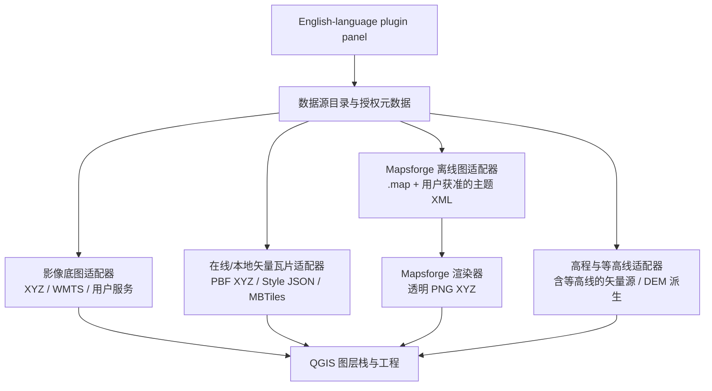

# QGIS 多源底图与矢量叠加插件：系统设计与开源计划

**状态：方案稿。尚未按本方案实现，也未发布 GitHub / Gitee 仓库。**  
**项目暂名：QGIS Map Overlay Studio（可在建仓前改名）**

## 1. 目标与验收边界

做成可安装的 QGIS 插件，管理卫星/影像底图、在线矢量切片、本地 Mapsforge `.map` 文件，并把路网、等高线作为独立可开关的叠加层。**首个公开版本使用英文界面**：菜单、面板、设置、提示、状态和错误信息统一为 English。README、安装指南和故障排查也提供英文版本。

“测试通过再上线”作为硬门槛：干净 QGIS 配置安装、在线与离线源、道路和等高线、授权清单、公开截图、打包扫描全部通过后，再将仓库设为公开并发布版本。方案阶段不创建远程仓库、不推送代码，也不发布文章。

## 2. 当前原型的实测边界

- 现有原型已在 QGIS 4.2.3 安装并启用，能够连接本机 Mapsforge 服务，面板可切换主题、透明叠加/底图、注记、水系、等高线筛选和图层透明度。
- 当前 `.map` 经本机 Mapsforge 服务渲染成 PNG XYZ 瓦片，再以 QGIS 栅格瓦片图层显示。`.map` 的源数据是矢量地图，但当前插件图层不是 QGIS 原生 MVT 图层，也不能编辑其中的要素。
- 当前“显示等高线”只筛选地图源中已有的等高线类别；地图文件不含等高线时，勾选也不会生成等高线。
- 当前插件源码把工作区路径写死，并依赖 `127.0.0.1:18766` 的本机服务。公开发行前必须移除本机路径依赖，并将渲染服务纳入可复现的安装方案；若无法确认服务源码和许可，则改为插件直接调用许可兼容的渲染组件。
- 已有真实 QGIS 面板截图：`../assets/qgis-plugin-panel-actual.jpg`。它是当前中文原型的实机截图，路径和主题仍带本机素材信息，不作为公开版最终配图；公开版需在干净配置中用许可清楚的数据重拍。

## 3. 系统结构



### 图层职责

| 类型 | 入口与 QGIS 图层 | 作用与限制 |
|---|---|---|
| 卫星/影像底图 | 有授权的 XYZ、WMTS 或用户本地影像；QGIS 栅格图层 | 作为最底层；提供方、许可、归属文字必须随图层记录。默认目录不预置未经核准的影像瓦片地址。 |
| 在线矢量切片 | HTTP/S XYZ `.pbf`、Style JSON/TileJSON；QGIS 原生矢量瓦片图层 | 可按道路类别构建透明路网样式，标注与道路可分层。瓦片是渲染数据，不等于可编辑的普通矢量要素。 |
| 本地矢量切片 | 本地 XYZ `.pbf` 或 `.mbtiles`；QGIS 原生矢量瓦片图层 | 离线显示及样式管理；需要编辑时另行导出/获取 GeoPackage 等要素数据。 |
| Mapsforge `.map` | `.map` + 用户有权使用的主题 XML；本机渲染输出 PNG XYZ，QGIS 栅格图层 | 延续当前离线图能力，可将道路主题设为透明叠加；若源文件不含等高线，不能仅靠主题造出等高线。 |
| 等高线 | 瓦片中真实存在的 contour source-layer、Mapsforge 源中的等高线类别，或由用户 DEM 派生 | 独立透明线层，独立开关、线宽、颜色、间隔、比例尺可见性和透明度。生成型流程记录 DEM、垂直单位、间隔、坐标系与处理参数。 |

推荐图层顺序：**卫星/影像 → 等高线 → 路网 → 地名/轨迹**。道路优先级高于等高线；地名避免被遮挡。插件只管理图层和样式，不自动保存用户 QGIS 工程。

### 数据源目录

数据源用独立清单保存 `id`、中英文名称、数据类型、URL 或 style URL、归属文字、许可说明、提供方网页、最大/最小缩放级别、认证配置引用和等高线能力。清单禁止存放访问令牌、个人路径或瓦片缓存。

- **Mapsforge `.map` 预设入口：** 地区目录指向 Mapsforge 官方下载索引，由用户打开官方页面、选取地区并下载，再在插件中选择本地文件。先提供官方地区索引和来源信息，不抓取网页、不批量下载、不把地图文件镜像进插件包。官方索引：[Mapsforge Maps v5](https://download.mapsforge.org/maps/v5/)。
- **OpenAndroMaps：** 可提供官方地图目录页面作为用户查阅入口，不做直链或自动下载，不随项目打包地图。其许可明确限制地图文件再分发；Elevate 等主题集成需逐项确认许可/书面许可。[官方地图下载页](https://www.openandromaps.org/en/downloads) · [许可说明](https://www.openandromaps.org/en/license)。
- **在线矢量瓦片：** 首个候选为 OpenFreeMap Style URL，设计时不要求内置令牌；另允许用户自行填写符合 QGIS 格式的 XYZ/Style JSON/TileJSON 地址，以及选择本地 `.mbtiles`。截至 2026-10-16，OpenFreeMap 文档列出 Liberty、Bright、Positron 等样式，标注 OpenMapTiles 与 OpenStreetMap 来源；服务条件上线前复核。[OpenFreeMap Quick Start](https://openfreemap.org/quick_start/)。
- **令牌型服务：** 令牌通过 QGIS Authentication Manager 的认证配置引用，界面掩码显示；导出工程、日志、源码、截图不得包含令牌。采用具体提供方前先核对服务条款、覆盖范围、坐标偏移和配额。
- **卫星底图：** 预设目录只纳入许可明确且可在目标使用场景调用的服务；同时支持用户自有授权 URL。对外展示必须保留提供方归属，不复用本机缓存或未获授权的图源。

OpenFreeMap 的当前文档允许有限离线下载（每次不超过 3,000 瓦片或 50 MB、最多 4 个并发请求，并需唯一 User-Agent）；本项目第一阶段只做在线显示，不提供批量离线抓取。

## 4. 界面设计

主窗口分为“底图 / Base maps”和“叠加 / Overlays”两区，右侧显示当前图层栈和来源状态。顶部提供地区、数据源和缩放范围；图层行提供显示、顺序、透明度、样式和移除操作。

| 面板 | 功能 |
|---|---|
| 底图 | 影像服务、在线矢量底图、本地 `.map` / `.mbtiles`；显示在线/离线、许可归属、当前源状态。 |
| 叠加 | 道路、等高线、水系、轨迹；允许添加多层、重排、调透明度和按比例尺显隐。 |
| 风格 | 选择许可清楚的内置样式，加载用户主题；道路类型、线宽/颜色、标注字段及等高线级别分别设置。 |
| 等高线 | 检测源能力。无等高线时说明“当前数据源未提供”，显示“从 DEM 生成”入口，而不是空勾选框。 |
| 来源与认证 | 显示归属、许可证、源链接和认证配置名称；任何 token 均不回显。 |
| Language | English-only interface for the first public version; menu items, controls, status text, dialogs, and errors use English consistently. |

六种本机主题可以作为“用户主题导入”需求继续支持；公开安装包先带项目自制、可再分发的基础样式。已有主题 ZIP 需逐项完成授权检查，未核准前不进入公开代码、安装 ZIP、截图或样例工程。

## 5. 实施阶段与验收门槛

### P0：开源前清理与许可

- 从当前大工作区提取一个干净的插件源码目录，不把整库或本地 `_inbox` 素材推上远端。
- 移除硬编码的 `D:\AIAssistant\...` 路径；明确 Mapsforge 渲染器源码、依赖和许可。新机器从 README 能安装并启动，不能依赖未公开的本地服务。
- 审核 `.map`、主题 XML、卫星缓存、样图及底图地址；建立 `THIRD_PARTY_NOTICES.md`、数据源许可表和 `.gitignore`。
- 选定插件源代码许可证及作者归属；提供 `LICENSE`、安装说明、变更记录和问题反馈入口。

**P0 通过条件：** 干净工作区只有可发布代码/文档/经过许可检查的截图；仓库检索不到个人路径、token、私有数据或未经授权图源。

### P1：可移植的 Mapsforge 离线图

- 加入官方地区索引入口、`.map` 文件选择、多文件/地区图层管理和源元数据。
- 将本机渲染服务变成随插件发行或可明确安装的许可兼容组件；按源图能力启用道路、等高线等主题筛选。
- 默认主题由项目自制；外部主题由用户导入并确认其使用权。

**P1 通过条件：** 在无原项目目录的新 QGIS 配置里选择授权样例 `.map` 后能渲染，生成的 QGIS 图层明确标为“渲染栅格瓦片”；不存在等高线时 UI 给出具体原因。

### P2：真正的矢量瓦片

- 在线加载 PBF XYZ 与 Style JSON/TileJSON；本地加载 `.mbtiles`，优先复用 QGIS `QgsVectorTileLayer`。
- 添加“仅道路”样式，将道路类别和标签规则映射到实际 source-layer；保留来源归属及比例尺范围。
- 添加 OpenFreeMap 样式预设与自定义源入口，不硬编码个人 token，不承诺第三方服务永久可用。

**P2 通过条件：** 图层属性明确显示矢量瓦片；在线源和本地 MBTiles 都能显示道路；切换主题、标注、透明度、缩放级别后样式仍正确。需编辑要素时明确提示矢量瓦片不是原始可编辑数据。

### P3：等高线与组合叠加

- 优先读取矢量瓦片 source-layer 或 `.map` 里真实存在的等高线类别。
- 对无等高线源，提供从用户 DEM 派生的可选流程：选择高程数据和等高距，生成 GeoPackage 等高线图层；记录 DEM 来源、许可、水平/垂直单位、坐标系和等高距。
- 把等高线、道路分成独立层，验证“影像 + 等高线 + 道路 + 注记”层序与比例尺可见性；避免路网被等高线压住。

**P3 通过条件：** 至少有一份许可清楚的 DEM/等高线输入；画面中能目视确认等高线、道路均存在，能各自关闭并调整样式。没有实际输入数据时，不宣称完成等高线功能。

### P4：英文界面、测试、实机截图与发布候选

- QGIS 兼容矩阵：先验证目标用户当前的 QGIS 4.2.3；再确定可承诺的最低版本。若承诺 3.34 LTR，则必须在该版本独立完成同一验收。
- 覆盖干净配置安装/卸载、离线文件缺失、渲染器不可用、在线服务超时、认证失败、无等高线能力、工程保存提示、切换语言、路径含中文/空格等用例。
- UI 自动/单元检查与手工地图验收都记录结果；每个发布候选附版本、环境、测试记录、缺陷关闭清单和安装 ZIP SHA-256。
- 从真实运行的 QGIS 录制/截取公开截图：英文插件面板、影像+道路、影像+道路+等高线、六主题对照。不得用仿真界面；截图选用许可清楚的数据，保留地图归属，清除个人路径、令牌、未授权主题名和桌面隐私。

**P4 通过条件：** 所有阻断项为零；支持语言画面真实可读；上述截图都来自通过验收的候选构建。当前已有的中文原型截图只用作内部方案参考。

### P5：GitHub / Gitee 上线

1. 建立干净的发布目录和本地版本标签，完成两人式（作者自查 + 独立复核）数据许可与密钥扫描。
2. 在用户账号下先建私有候选仓库，提交唯一的可发布源码，不从工作区总仓库直接推送；用已配置的账号凭据检查权限，不打印或写入 token。
3. 测试通过后将 GitHub 设为主仓库，发布带说明和校验值的版本包；Gitee 作为同一 tag/commit 的镜像，验证网页源码、下载 ZIP、截图和文档均一致。
4. 发布页明确列出 QGIS 版本、Mapsforge/矢量瓦片数据差异、服务依赖、数据源许可、归属要求、等高线生成条件与已知限制。

GitHub 仓库与 Release 的操作遵循其官方文档：[创建仓库](https://docs.github.com/en/repositories/creating-and-managing-repositories/creating-a-new-repository)、[管理 Releases](https://docs.github.com/en/repositories/releasing-projects-on-github/managing-releases-in-a-repository)。Fine-grained token 仅授予实际需要的仓库权限并经凭据管理器使用；官方权限表：[Fine-grained PAT permissions](https://docs.github.com/en/rest/authentication/permissions-required-for-fine-grained-personal-access-tokens)。Gitee 的公开状态、凭据权限及 Release/附件流程在执行时按账号当前界面和帮助中心复核：[Gitee 帮助中心](https://help.gitee.com/)。

## 6. 公开仓库结构建议

```text
qgis-map-overlay-studio/
├─ plugin/qgis_map_overlay/       # QGIS 插件源码
├─ renderer/                      # 若许可允许，放可复现的 Mapsforge 渲染组件
├─ styles/                        # 项目原创、许可兼容的样式
├─ catalog/sources.json           # 无密钥的数据源目录
├─ docs/                          # 英文安装说明、架构、截图、授权清单
├─ tests/                          # 单元/打包/数据能力检查
├─ LICENSE
├─ THIRD_PARTY_NOTICES.md
├─ README.md
└─ .gitignore
```

## 7. 外部格式和合规依据

- QGIS 当前支持远程 HTTP/S XYZ PBF、本地 XYZ PBF 与本地 MBTiles 矢量瓦片，并允许 Style URL 或自建规则：[QGIS 4.2 矢量瓦片说明](https://docs.qgis.org/4.2/en/docs/user_manual/working_with_vector_tiles/vector_tiles.html)。
- QGIS 插件发布需要准备合规元数据、许可文件和插件包：[QGIS 插件发布指南](https://docs.qgis.org/testing/en/docs/pyqgis_developer_cookbook/plugins/releasing.html)。
- OpenStreetMap 数据归属按场景显示，地图截图需要清晰署名并链接版权说明：[OSMF Attribution Guidelines](https://osmfoundation.org/wiki/Attribution_Guidelines)。
- 数据提供方、格式、许可和下载规则在开源前复查；本方案中的服务能力是 2026-10-16 查阅资料形成的候选，不等于长期可用承诺。
