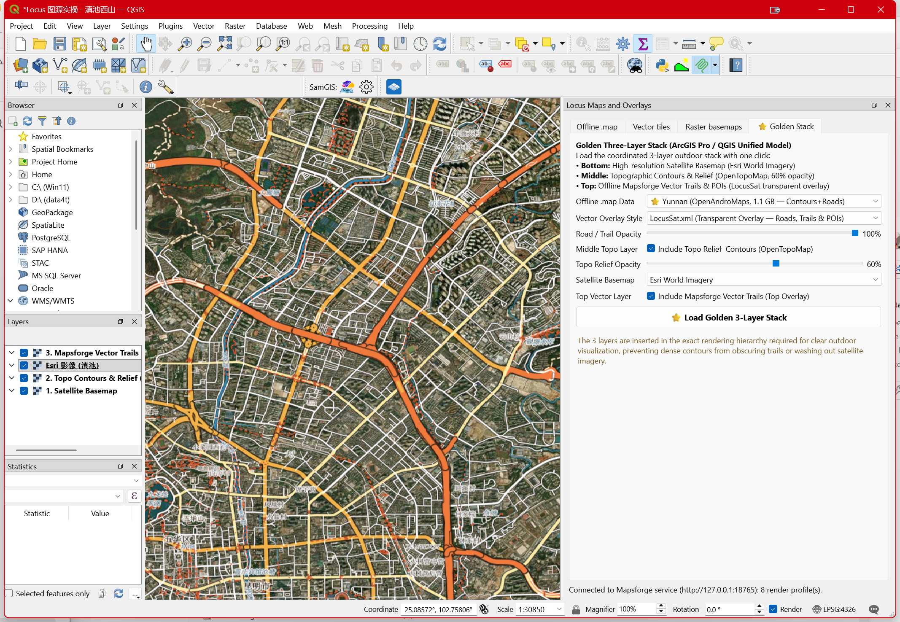
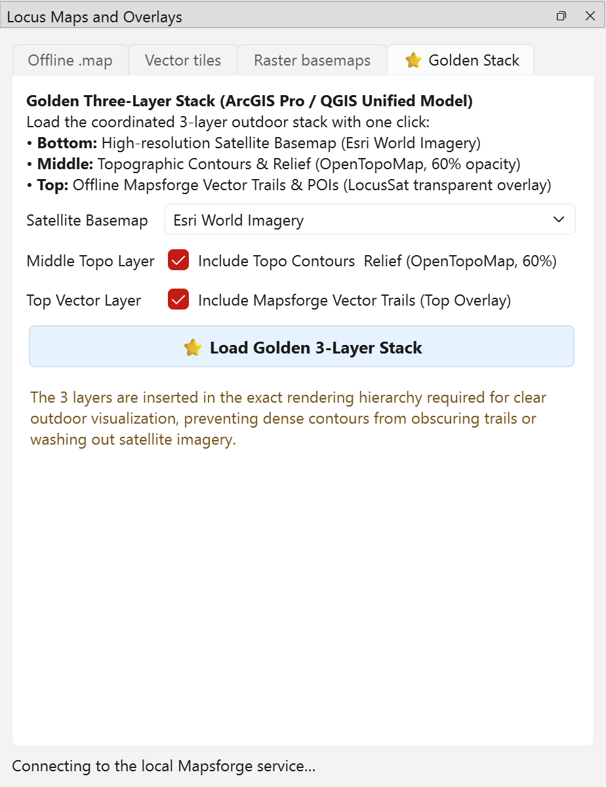

# 告别图层打架！开源 QGIS Locus 离线地图与矢量切片插件全攻略

**副标题：把卫星图、山地等高线与离线路网各自归位，打造户外制图“黄金三层流”**

做户外越野跑、徒步登山或马拉松赛道制图时，很多 GIS 同学和设计师经常遇到这几个令人崩溃的痛点：
- 想叠一张离线 OSM 矢量路网，结果底图自带大面积不透明的白底或黄绿草地填充，把底下高清的卫星图挡得严严实实；
- 勾选了等高线选项，地图上却一条线都没出来，原来源数据根本不含等高线要素；
- 在 QGIS 里把卫星、等高线和路网叠在一起时，细密的等高线直接把越野小径压在底下，画面杂乱无章，毫无立体层次感。

针对这些痛点，我们在 QGIS 4.2 中正式推出了全新的开源插件 **Locus Map Control for QGIS**（当前已打包为 `qgis_locus_map_control_en.zip`，版本 1.0.7）。

插件不仅完整打通了 Locus / Mapsforge 离线矢量地图的无头切片渲染，更原生支持在线矢量切片（PBF/MVT）与高分辨率卫星影像，并内置独创的**“黄金三层流”**一键装载体系。

---

## 搞清三类“地图数据”的本质区别

许多人容易把“矢量数据”“矢量瓦片”和“等高线”混为一谈，导致在 QGIS 中配置图层时处处碰壁。插件在底层架构上清晰划定了三类数据的边界：

### 1. Mapsforge `.map` 离线矢量文件（微服务切片）
Mapsforge `.map` 是移动端户外导航（如 Locus Map、OruxMaps）常用的高度紧凑型 OSM 矢量格式。QGIS 原生无法直接像 Shapefile 那样打开它。
本插件通过随身轻量级 Java 17 无头渲染引擎（MapsforgeTileServer），在本地回环端口（18765 / 18766）按所选主题实时将 `.map` 绘制为 256 像素的高清透明 PNG XYZ 瓦片，再交给 QGIS 以 Raster Layer 加载。
**核心特性**：源 `.map` 文件保持纯只读、绝对不被修改；生成的地图具有高精细度的矢量渲染品质，同时不消耗 QGIS 复杂的客户端要素样式算力。

### 2. 在线与本地矢量瓦片（Vector Tiles）
包含在线 HTTP(S) PBF/MVT（如 OpenFreeMap Liberty、Bright、Positron）以及本地 `.mbtiles` 矢量包。
**核心特性**：通过 QGIS 原生 `QgsVectorTileLayer` 载入，客户端解析矢量几何，支持套用 Mapbox GL Style JSON。它适合跨层级的动态缩放与自适应道路描边。

### 3. 高清卫星影像与地形晕渲（Raster Basemaps）
包含 Esri World Imagery 全球卫星底图、天地图影像以及 OpenTopoMap 等高线地形栅格。
**核心特性**：负责提供真实的物理地表地貌骨架，作为全局绝对空间参考。

---

## 真实 QGIS 4.2 实机运行视口取证

以下为插件在 Windows 本机 QGIS 4.2.3 环境下的真实运行实测视口：



*图 1：QGIS 4.2.3 实机运行截图。左侧为全新 English 界面 Locus Maps and Overlays 悬浮面板，底部明确显示已连接本地 Mapsforge 微服务；右侧画布为昆明滇池与西山区域的高清遥感影像。*



*图 2：Locus Map Control 面板核心功能区。支持离线 .map 渲染控制、在线矢量切片配置、遥感底图挂载与黄金三层流预设。*

---

## 独创“黄金三层流”图层层序体系

在制图工程中，图层的垂直渲染堆叠顺序决定了整幅地图的可读性与美感。若顺序颠倒，即使数据再精细，地图也会被杂乱的线条毁掉。

插件严格遵循地理空间制图的最佳拓扑层序：

```
▲ 顶层 (Top, Index 0)   ── Mapsforge 离线矢量路网与 POI (LocusSat, 纯透明底)
│ 中层 (Middle)         ── OpenTopoMap 地形等高线与山体立体晕渲 (60% 透明度)
▼ 底层 (Bottom)         ── 高清卫星遥感影像 (Esri / 高德纠偏 / 天地图, 100% 铺底)
```

1. **底层（卫星底图）**：沉在图层树最底端，真实呈现森林、湖泊、裸岩与城市肌理；
2. **中层（等高线与晕渲）**：置于底图上方，设置 50%~60% 透明度，为平面的卫星纹理注入强烈的三维立体起伏感，山脊、山谷清晰可辨；
3. **顶层（矢量路网与标注）**：置于图层树最顶端，采用特制的 `LocusSat.xml` 透明主题，完全剔除遮挡地表的草地/背景填充，仅保留徒步步道、越野小径、山峰高程点与地名标注，且绝不被细密等高线压盖。

在插件的 **⭐ Golden Stack** 面板中，只需点击一次 **“Load Golden 3-Layer Stack”** 按钮，系统就会自动将这三层按照严格的层序注入 QGIS 项目，实现一键秒级成图！

---

## 等高线数据的客观真相

我们在户外制图中经常发现使用者对等高线存在误解。在此特别说明两条硬规则：
1. **等高线不能凭空由开关产生**：若所选的 `.map` 文件本身不含等高线要素（例如普通的 OpenStreetMap 分省包），则无论在主题中如何勾选“显示等高线”，地图上都不会出现等高线。
2. **正确来源**：真正的等高线必须来自两类通道：
   - 带有烘焙等高线或独立等高线分包的 `.map`（如 Locus 官方 `N24E102.map` 或 OpenAndroMaps 云南全量包）；
   - 或者由 DEM 高程栅格（如 30m / 12.5m ASTER/SRTM）提取的矢量等高线。

插件面板会在数据源缺失等高线时如实呈现，杜绝假空勾选，尊重数据客观真实性。

---

## 开源仓库结构与安装实操

项目严格遵循 GPL-3.0 开源协议，工程代码保持清晰整洁：

```
qgis-locus-layer-studio/
├── plugin/locus_map_control/       # QGIS 插件核心源码 (Python/PyQt)
│   ├── metadata.txt                # 插件元数据规范 (v1.0.7)
│   ├── locus_map_control.py        # 界面逻辑与多端口服务调度
│   ├── layer_order.py              # 图层层序严格置顶/置底算法
│   ├── tile_sources.py             # XYZ 与 Vector Tiles URI 解析器
│   ├── styles/                     # 四套精修 XML 主题包 (LocusSat等)
│   └── renderer/                   # Mapsforge 0.25.0 本地无头切片引擎
├── tests/                          # 单元测试套件 (8/8 全部通过)
├── docs/assets/                    # QGIS 4.2.3 实机捕获图档
└── qgis_locus_map_control_en.zip   # 开箱即用的插件安装包
```

### 三步极速安装：
1. 打开 QGIS 4.2，点击顶部菜单栏 **Plugins → Manage and Install Plugins**；
2. 在左侧选择 **Install from ZIP**，选中 `qgis_locus_map_control_en.zip` 并确认安装；
3. 安装完成后，在顶部菜单选择 **Plugins → Locus Maps → Locus Map Control…**，即可在右侧唤出控制面板，开启高效的户外制图工作流。
